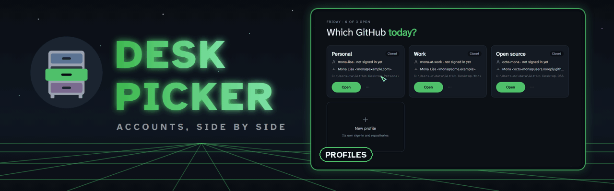
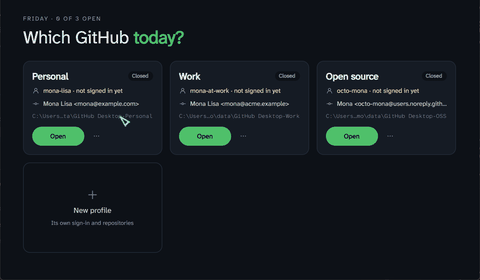
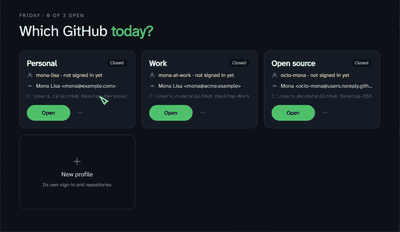
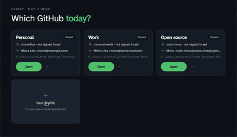
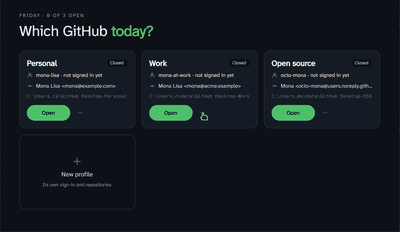
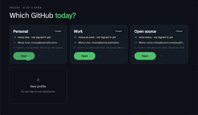

<p align="center">
  
</p>

<p align="center">
  
  
  
  
  
</p>

<p align="center">
  <a href="#what-it-does">What it does</a> ·
  <a href="#see-it-in-action">See it in action</a> ·
  <a href="#getting-started">Getting started</a> ·
  <a href="#build">Build</a> ·
  <a href="#roadmap">Roadmap</a>
</p>

<table>
<tr>
<td width="52%"></td>
<td>

### Accounts, side by side

Run several copies of GitHub Desktop side by side, each signed in to a different GitHub account, such as work and personal.

GitHub Desktop only keeps one GitHub.com account at a time. DeskPicker gives each profile its own data folder (Electron's `--user-data-dir`), so each copy has its own sign-in and repository list. You always sign in through Desktop's own browser flow. DeskPicker never sees a password or token.

</td>
</tr>
</table>

> [!NOTE]
> Windows is where DeskPicker is tested. The macOS and Linux builds run but are untested; see [Platforms](#platforms).

## What it does

- **Profiles.** Each profile is a Desktop data folder. "Main" is Desktop's normal folder. Profiles are kept in `profiles.json` next to the app. Removing a profile never deletes its folder.
- **Sign-in hand-off.** The browser always sends Desktop's `x-github-desktop-auth://` sign-in link to the main copy (on macOS, to whichever copy was started first). While a profile is signing in, DeskPicker catches the link and passes it on to that profile. It tells which profile is waiting from that profile's own Desktop log. The link is never saved or logged.
  - Windows: DeskPicker spots the short-lived `GitHubDesktop.exe --protocol-launcher <link>` process and starts the profile with the same link.
  - Linux: the same, with the process that carries the link there (`xdg-open <link>`, `github-desktop <link>`, or `bwrap … <link>` for the Flatpak).
  - macOS: links arrive as an Apple Event, not on a command line. While a profile is waiting, DeskPicker.app makes itself the app that opens these links (taking them back each time a Desktop starts, since Desktop claims them on launch). It sends the link to that profile's Desktop process as the same Apple Event, then gives the links back to Desktop. Run DeskPicker as the `.app` from `build.sh`, from `/Applications` or `~/Applications`. If it stops unexpectedly mid-sign-in, the next link it receives goes on to your main copy.
- **Commit identity per profile.** Each profile can have its own commit name and email. DeskPicker writes `~/.deskpicker/<folder>.gitconfig`, which includes your real `~/.gitconfig` and then sets the profile's identity. It starts that copy with `GIT_CONFIG_GLOBAL` pointing at the file. Your global git config and command-line git are left alone, and Desktop's "Configure Git" step writes to the profile's file instead.
- **Signed-in badge.** On Windows, DeskPicker checks Credential Manager for a `GitHub - https://api.github.com/<login>` entry. It reads the entry names only.
- **Shortcuts.** A shortcut runs `DeskPicker --open "<name>"`, so the profile's commit identity comes along.

## See it in action

Every clip is the real project, recorded with Readmotion. Nothing is mocked up.

<table>
<tr>
<td align="center"><br><b>Profiles</b>: who each account signs in as, and commits as</td>
<td align="center"><br><b>New</b>: a new profile gets its own data folder, named as you type</td>
</tr>
<tr>
<td align="center"><br><b>Identity</b>: each profile commits with its own name and email</td>
<td align="center"><br><b>Open</b>: each profile opens its own GitHub Desktop, next to the others</td>
</tr>
</table>

## Getting started

1. Build it (see [Build](#build)) and run `DeskPicker.exe`. The Main profile is GitHub Desktop's normal folder.
2. Click **New profile**, name it, and optionally give it a GitHub login and a commit name and email.
3. Click **Open**, then sign in from that copy's window as usual.

## Build

Needs the [.NET 10 SDK](https://dot.net).

- Windows: `build.cmd`, which builds `DeskPicker.exe` here.
- macOS / Linux: `./build.sh`, which builds into `dist/<target>/` (a `.app` on macOS).

## Platforms

| | Windows | macOS | Linux (shiftkey/desktop: .deb and Flatpak) |
|---|---|---|---|
| Profiles, launch, running status | yes | yes (CI) | yes (CI) |
| Commit identity | yes | yes (CI: `open --env` reaches Desktop) | yes (CI: Desktop passes `GIT_CONFIG_GLOBAL` on; Flatpak `--env` reaches the sandbox) |
| Sign-in hand-off | yes | yes (CI, with a stand-in link) | yes (CI, with a stand-in link) |
| Signed-in badge | yes | no | no |

"CI" means checked on GitHub's hosted runners by [`platform-tests`](.github/workflows/platform-tests.yml) against a real GitHub Desktop install: macOS with the official app, Ubuntu with the shiftkey/desktop `.deb` and the `io.github.shiftey.Desktop` Flatpak. The scripts are in [`ci/`](ci/) and their results are in each run's summary. The sign-in check uses a made-up `x-github-desktop-auth://` link, so it proves the link reaches the waiting copy but not a full sign-in to an account. Not yet checked on a real Mac or Linux desktop:
- a real browser sign-in end to end;
- on macOS, whether the system asks for permission ("DeskPicker wants to control GitHub Desktop") before DeskPicker passes the link on. CI runners don't show that prompt.

## Development

```
assets/   fonts: Atkinson Hyperlegible (SIL OFL)
src/      the app: Avalonia on .NET 10
tools/    the icon maker, and readmotion/: the config, demo profiles and driver that record this README's media
```

### Recording the README media

The GIFs above are made with Readmotion from `tools/readmotion/readmotion.json`. It runs a copy of the app from `tools/readmotion/.work/demo/` with the made-up profiles in `demo_profiles.json`, so no real account shows, and `driver.py` moves the mouse. Build that copy first, since building is slower than the recording waits:

```
python tools/readmotion/demo.py --build
```

Then open the config in the Readmotion app and click **Record all**, then **Create README**, or from a terminal. Keep the screen unlocked and the window uncovered while it records:

```
readmotion-cli capture tools/readmotion/readmotion.json
readmotion-cli build tools/readmotion/readmotion.json
```

## Roadmap

- [x] Profiles, launch and running status on Windows
- [x] Commit identity per profile
- [x] Sign-in hand-off on Windows
- [x] Test on macOS and Linux (in CI)
- [x] Sign-in hand-off on macOS and Linux
- [ ] A real browser sign-in on a Mac and a Linux desktop (CI uses a stand-in link)
- [ ] Signed-in badge on macOS and Linux

## License

Fonts: AtkinsonHyperlegibleMono, AtkinsonHyperlegibleNext (each under its own license, in the repo).
